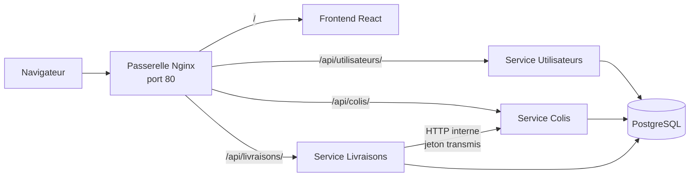

# SenTransport

[](https://github.com/patricisto1-arch/sentransport/actions/workflows/ci-cd.yml)

Plateforme de **suivi de colis et de livraisons**, construite en microservices et livrée par une chaîne **CI/CD GitHub Actions**. Projet du module DevOps de L3 (Dakar Institute of Technology), réalisé en groupe de six.

Un client enregistre un colis, un administrateur l'affecte à un livreur, le livreur met à jour son statut, et le client suit l'avancement.

## Sommaire

1. [Fonctionnalités](#fonctionnalités)
2. [Architecture](#architecture)
3. [Structure du dépôt](#structure-du-dépôt)
4. [Lancer l'application en local](#lancer-lapplication-en-local)
5. [Tests](#tests)
6. [CI/CD](#cicd)
7. [Workflow Git](#workflow-git)
8. [Déploiement](#déploiement)
9. [Documentation complémentaire](#documentation-complémentaire)
10. [Équipe](#équipe)
11. [Limites connues](#limites-connues)

## Fonctionnalités

| Rôle | Ce qu'il peut faire |
|---|---|
| **Client** | S'inscrire, se connecter, créer un colis, voir et modifier ses colis tant qu'ils sont en attente, suivre leur statut |
| **Livreur** | Voir les courses qui lui sont affectées, passer une livraison en transit, livrée ou en échec |
| **Administrateur** | Voir tous les colis, affecter un colis à un livreur, supprimer un colis, gérer les statuts |

Cycle de vie d'un colis et d'une livraison :

```
en_attente ──► en_transit ──► livre
     │              │
     └──────────────┴──────► echec
```

Les statuts `livre` et `echec` sont définitifs.

## Architecture



- Le **navigateur ne parle qu'à la passerelle**, qui redirige vers le bon service en retirant le préfixe `/api/<service>`.
- Chaque service est une application **FastAPI** indépendante, dans son propre conteneur, écoutant sur le port 8000.
- Les trois services partagent une base **PostgreSQL**, mais chacun n'écrit que dans ses propres tables.
- Le service **Utilisateurs** délivre le jeton JWT à la connexion. Les services **Colis** et **Livraisons** le vérifient eux-mêmes avec le secret partagé `JWT_SECRET`.
- Quand un livreur change le statut d'une livraison, le service **Livraisons** appelle le service **Colis** pour garder les deux statuts synchronisés.

| Brique | Technologie |
|---|---|
| Frontend | React, TypeScript, Vite, Tailwind CSS |
| Services | Python 3.12, FastAPI, SQLAlchemy / psycopg2, PyJWT, Argon2 |
| Base de données | PostgreSQL 16 |
| Passerelle | Nginx 1.27 |
| Conteneurs | Docker, Docker Compose |
| CI/CD | GitHub Actions, GitHub Container Registry (`ghcr.io`), Trivy |

## Structure du dépôt

```
sentransport/
├── .github/workflows/ci-cd.yml   Workflow GitHub Actions
├── services/
│   ├── utilisateurs/             Comptes, authentification, jetons JWT
│   ├── colis/                    Gestion des colis
│   └── livraisons/               Affectation et suivi des livraisons
├── frontend/                     Application React
├── gateway/nginx.conf            Configuration de la passerelle
├── database/init.sql             Schéma PostgreSQL et données de démonstration
├── tests/integration/            Tests de bout en bout (parcours complet)
├── docs/
│   ├── contrats-api.md           Contrats d'API et schéma de données
│   └── guide-deploiement.md      Mise en production
├── docker-compose.yml            Lancement de toute l'application
└── README.md
```

## Lancer l'application en local

### Prérequis

- **Docker Desktop** installé et lancé.
- Le port **80** libre sur votre machine.
- **Git**.

### Étapes (PowerShell, à la racine du dépôt)

**1. Récupérer le code**

```powershell
git clone https://github.com/patricisto1-arch/sentransport.git
cd sentransport
git checkout develop
```

**2. Créer le fichier `.env`** à la racine. Il est ignoré par Git : ne le commitez jamais.

```powershell
@"
REGISTRY=local
TAG=latest
POSTGRES_PASSWORD=test_local_pwd_123
JWT_SECRET=secret-de-test-local-au-moins-32-caracteres-123456
"@ | Set-Content -Path .env -Encoding ascii
```

**3. Construire les quatre images.** Le fichier `docker-compose.yml` utilise des images publiées par la CI ; en local, on les construit sous le nom `local/<service>:latest`.

```powershell
docker build -t local/colis:latest services/colis
docker build -t local/utilisateurs:latest services/utilisateurs
docker build -t local/livraisons:latest services/livraisons
docker build -t local/frontend:latest frontend
```

**4. Lancer**

```powershell
docker compose up -d
docker compose ps
```

Attendez que `db`, `colis`, `utilisateurs`, `livraisons` et `frontend` soient `healthy` (30 à 60 secondes), puis ouvrez **http://localhost**.

### Comptes de démonstration

| Rôle | E-mail | Mot de passe |
|---|---|---|
| Administrateur | `admin.demo@sentransport.sn` | `Demo1234!` |
| Livreur | `livreur.demo@sentransport.sn` | `Demo1234!` |
| Client | `client.demo@sentransport.sn` | `Demo1234!` |

Un compte créé par l'inscription est toujours un **client**. Un jeton est valable **1 heure**.

### Arrêter ou repartir de zéro

```powershell
docker compose down        # arrêter
docker compose down -v     # arrêter et supprimer la base (obligatoire après un changement de init.sql)
```

Après un `git pull`, reconstruisez les images des services modifiés (étape 3).

### Problèmes fréquents

| Symptôme | Cause probable | Solution |
|---|---|---|
| `failed to connect to the docker API` | Docker Desktop n'est pas lancé | Le démarrer et attendre « Engine running » |
| Variable `REGISTRY` non définie | Le `.env` manque ou est mal placé | Le recréer à la racine du dépôt |
| `pull access denied` ou `No such image: local/...` | Les images ne sont pas construites | Refaire l'étape 3 |
| `port is already allocated` (80) | Un autre programme utilise le port 80 | Le fermer puis relancer |
| Page HTML au lieu de JSON dans les tests | Anciennes images ou ancienne base | `docker compose down -v`, reconstruire les images, relancer |

## Tests

| Niveau | Commande | Où |
|---|---|---|
| Unitaires, un service | `pytest` | dans `services/colis`, `services/utilisateurs` ou `services/livraisons` |
| Unitaires, frontend | `npm test` | dans `frontend` |
| Intégration (parcours complet) | `pytest tests/integration -v` | à la racine, application lancée |

Pour les tests de service : `pip install -r requirements.txt pytest pytest-cov` dans le dossier du service. La couverture minimale exigée est de **60 %**.

Pour les tests d'intégration, l'application doit tourner (`docker compose up -d`), puis :

```powershell
pip install pytest httpx
pytest tests/integration -v
```

Résultat attendu : **5 tests qui passent**. S'ils sont « skipped », l'application n'est pas joignable sur http://localhost.

## CI/CD

Le workflow `.github/workflows/ci-cd.yml` se déclenche à chaque push sur `main` ou `develop` et à chaque Pull Request vers ces branches.

| Job | Rôle | Quand |
|---|---|---|
| `test-service` (×3) | Tests unitaires de Colis, Utilisateurs, Livraisons, couverture ≥ 60 % | toujours |
| `test-frontend` | Tests et build du frontend | toujours |
| `lint-python` | Style du code Python avec flake8 (lignes de 120 caractères au plus) | toujours |
| `trivy-scan` | Scan de sécurité (vulnérabilités, configuration, secrets) | toujours |
| `package` | Construit les 4 images Docker et les publie dans `ghcr.io` (étiquettes `latest` et SHA du commit) | push sur `develop` ou `main` |
| `deploy` | Déploie par SSH avec `docker compose` : `develop` vers `staging`, `main` vers `production` | push sur `develop` ou `main` |

Les secrets (`POSTGRES_PASSWORD`, `JWT_SECRET`, `SSH_PRIVATE_KEY`, `DEPLOY_HOST`) sont stockés dans les secrets GitHub, jamais dans le code. Le scan Trivy signale les failles sans bloquer le workflow.

## Workflow Git

- Branches : `main` (version livrée), `develop` (intégration), `feature/<tâche>` (travail de chacun).
- Personne ne pousse directement sur `main` ni `develop` : tout passe par une **Pull Request** vers `develop`.
- Une Pull Request est fusionnée quand le workflow est vert et qu'un autre membre l'a approuvée.
- Chaque tâche correspond à une issue GitHub, avec un label (`colis`, `utilisateurs`, `livraisons`, `frontend`, `infra`).
- Messages de commit courts : `feat(colis): création d'un colis`, `fix: import manquant`.

## Déploiement

Voir **[docs/guide-deploiement.md](docs/guide-deploiement.md)** : préparation du serveur, clé SSH, secrets, environnements, vérification et retour en arrière.

## Documentation complémentaire

- [`docs/contrats-api.md`](docs/contrats-api.md) : toutes les routes, les droits d'accès, les formats et le schéma de la base.
- [`docs/guide-deploiement.md`](docs/guide-deploiement.md) : mise en production.

## Équipe

| Membre | Rôle |
|---|---|
| Patrice Dione | Chef de projet, GitHub et pipeline CI/CD |
| Loubano-Voumbi Jordie | Service Colis |
| Ryghen Michel Valdick Mbenangoye | Service Utilisateurs et base de données |
| Boveldy Enoch Divin KENGANI | Service Livraisons et tests d'intégration |
| Mouhamadou Rassouloulahi Gueye | Frontend React |
| TEVOEDJRE Odilon Pamphile David Eloim Sissi | Passerelle, déploiement, sécurité et monitoring |

## Limites connues

- Les **listes de livraisons** sont accessibles à tout utilisateur connecté : le service Livraisons ne filtre pas encore selon le rôle.
- Le **motif d'un échec de livraison** saisi par le livreur n'est pas enregistré, l'API n'a pas de champ pour cela.
- Le **déploiement** n'a pas de HTTPS : en production, placer la passerelle derrière un certificat (par exemple Let's Encrypt).
- Les **comptes de démonstration** et leur mot de passe sont publics (ils sont dans `database/init.sql`) : à supprimer ou changer avant tout usage réel.
- Les services Colis et Livraisons répondent `422` aux données invalides, le service Utilisateurs répond `400` : formats d'erreur à harmoniser.
- Pas de messagerie ni de notifications serveur : le centre de notifications du frontend n'affiche que les actions faites dans la session.
